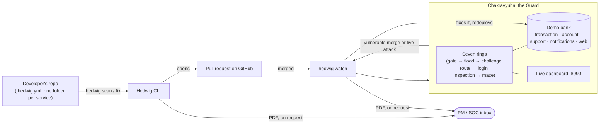
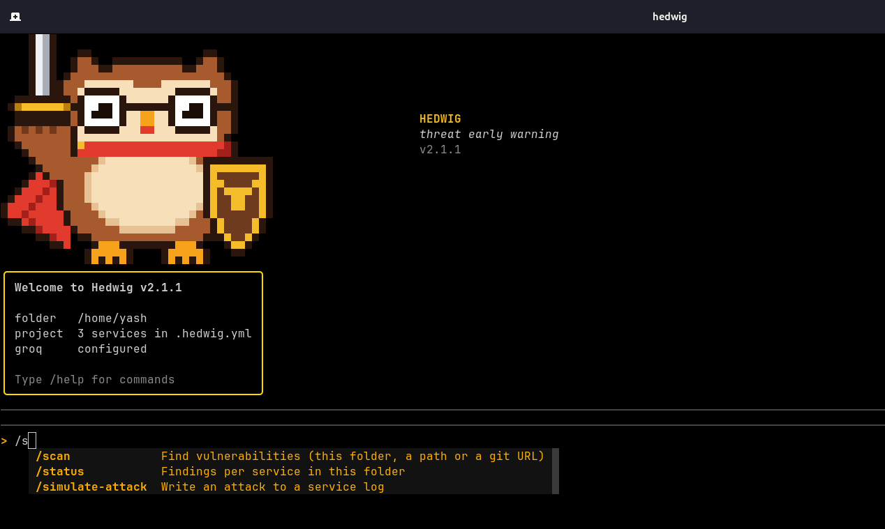
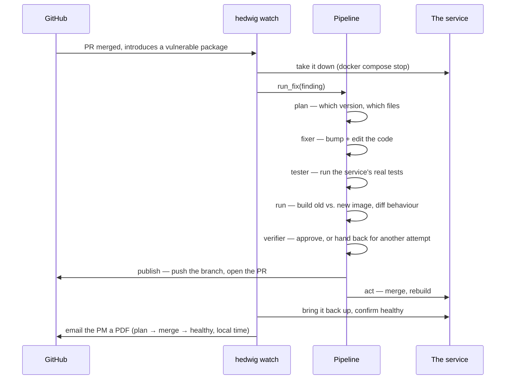
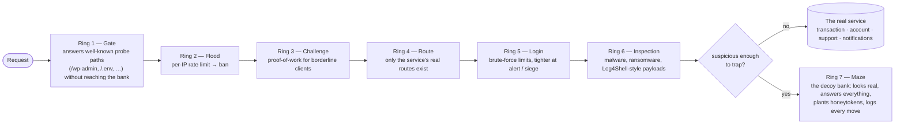

<p align="center">
  
</p>

<h1 align="center">Hedwig</h1>

<p align="center"><strong>🏆 2nd runner-up — D3COY 1.0, DJSCE</strong></p>

Developer-native cyber threat early warning. Hedwig reads threat intelligence, works out which
threats matter to your services, and responds inside limits your team has approved: it scans your
repo for vulnerable dependencies, ranks what actually matters, and — when you let it — fixes the
service itself: bumps the version, edits the code, tests it, and opens the pull request.

This repo is both Hedwig (the CLI) and the stage it was built and proved on: **Chakravyuha**, a
seven-ring runtime defence in front of a decoy bank, so Hedwig's autonomous-fix loop could be
demoed against a real, live attack instead of a slide.

<p align="center">
  
</p>

## Contents

- [What it does](#what-it-does)
- [How the pieces fit together](#how-the-pieces-fit-together)
- [Install](#install)
- [Commands](#commands)
- [The auto-fix pipeline](#the-auto-fix-pipeline)
- [Catching a vulnerable merge](#catching-a-vulnerable-merge)
- [Chakravyuha: the Guard and the decoy bank](#chakravyuha-the-guard-and-the-decoy-bank)
- [Malware and ransomware](#malware-and-ransomware)
- [Project layout](#project-layout)
- [Releasing](#releasing)

## What it does

Point Hedwig at a folder of services (each subfolder with a manifest — `package.json`, `pom.xml`,
`Cargo.toml`, `requirements.txt`, `composer.json` — is one service) and it will:

- **Scan** every service for known-vulnerable dependencies and rank the findings by real risk, not
  just CVSS — whether the vulnerable code is actually reachable matters.
- **Explain** any finding: the reasoning, the score factors, and the recommended fix.
- **Fix** a service on its own when you've allowed it to: bump the dependency, adapt the code the
  bump breaks, run the service's real tests, build the old and new images and diff their
  behaviour, and open a pull request — a normal PR when it's verified, a draft labelled
  `hedwig:unverified` when the tests couldn't run.
- **Watch** your repo for a vulnerable merge landing anyway, take the affected service down, fix
  it, and bring it back — see [the auto-fix pipeline](#the-auto-fix-pipeline) below.
- **Report**: a PDF for the PM after a fix, or a SOC report after an attack, each emailed on
  request.

Everything it decides on its own is governed by `.hedwig.yml` — per service, you choose the tier
and exactly what Hedwig is allowed to do (`open_fix_pr`, `auto_merge_if_verified`, `rollback`,
`takedown`). Nothing takes a service down or auto-merges a fix unless that service's config says
so.

## How the pieces fit together



Two independent halves meet at `hedwig watch`:

1. **Hedwig**, the CLI (`src/hedwig/`) — scans, explains, fixes, reports. It has no opinion about
   what it's protecting; point it at any repo.
2. **Chakravyuha**, the Guard (`guard/`) — a proxy with seven defensive rings in front of a small
   demo bank, built so Hedwig's reaction to a *real* attack (not a synthetic test) could be shown
   live. `hedwig watch --branch <b>` ties them together: it watches that branch for a vulnerable
   merge, takes the affected bank service down, fixes it the same way `hedwig fix` would, and
   brings it back up — all visible on the Guard's own dashboard.

## Install

Linux / macOS:

```sh
curl -fsSL https://github.com/D3C0Y-1-0/Hedwig/releases/latest/download/install.sh | sh
```

Windows (PowerShell):

```powershell
irm https://github.com/D3C0Y-1-0/Hedwig/releases/latest/download/install.ps1 | iex
```

Open a new terminal, `cd` into the folder that holds your services, and run:

```sh
hedwig
```

This opens the Hedwig app. Type `/` to see the commands.

<p align="center">
  
</p>

Run the install command again to update. The repo must be public for these links to work.

## Commands

| Command | What it does |
|---|---|
| `/init` | Create `.hedwig.yml` for the current folder. Each subfolder with a manifest is one service |
| `/scan [path\|git-url]` | Find known vulnerabilities, ranked by risk. Add `--offline`, `--json`. Defaults to this folder |
| `/status` | Findings per service in this folder |
| `/explain <id>` | Reasoning, score factors and the recommended fix for one finding |
| `/simulate-attack <service>` | Write an attack request to the service's log. Add `--compromise` for a sign of compromise |
| `/fix <service>` | Fix the service's vulnerable packages: bump, adapt the code, verify, push the branch and open a PR on GitHub (a draft when verification failed or could not run), then do what `.hedwig.yml` allows. Add `--package NAME`, `--dry-run`, `--no-pr`, `--no-email` |
| `hedwig watch [--branch B]` | Watch merged PRs (or one branch) for a vulnerable change landing; contain it the same way `fix` would — see below |
| `hedwig soc-report` | PDF for the SOC team after an attack on the bank (timeline, attackers, indicators, ATT&CK, actions). `--since 30m`, `--email` |
| `/down <service>`, `/up <service>` | Stop and start one service of the local Docker Compose bank (`docker compose stop` / `start`) |
| `/report <service\|run-id>` | PDF report for the project manager. Add `--email` |
| `/dash` | Terminal dashboard: the service architecture with live Docker status, alerts with expandable call sites, a reports table and the Guard's attack reports. Keys: `f` fix, `t` take down, `u` start, `a` approve, `e`/`c` expand/collapse, `1` `2` `3` tabs, `/` filter, `?` help |
| `/config` | Store your Groq API key (saved to `~/.hedwig/config.toml`). Also `/config show` and `/config set <key> <value>` |
| `/doctor` | Check git, docker, npm, cargo, composer, mvn, tectonic |
| `/clear`, `/help`, `/exit` | Clear the screen, list commands, leave |

Every command also works directly from a shell: `hedwig init`, `hedwig scan`, `hedwig status`,
`hedwig explain <id>`, `hedwig simulate-attack <service>`, `hedwig fix <service>`,
`hedwig watch`, `hedwig down <service>`, `hedwig up <service>`, `hedwig report <target>`,
`hedwig dash`, `hedwig config`, `hedwig doctor`, `hedwig --version`. `init` always works on the
folder you run it from.

### Fixing and reporting

`fix` needs a Groq key (`/config`), `git`, and for the old-vs-new comparison `docker`. To open the
pull request it needs the GitHub CLI (`gh auth login`) and a GitHub `origin`; without them the fix
stays on a local branch. It works in git worktrees under `.hedwig/work/`, never in your working
copy, and writes everything to `.hedwig/runs/<run-id>/` (`diff.patch`, `cases.json`,
`verdict.json`, `review.json`, `pr.md`). Every agent call and decision goes to
`.hedwig/audit.jsonl`. `report` builds the PDF with `tectonic`, which Hedwig downloads once into
`~/.hedwig/bin` on first use (the first report needs internet). `--email` sends it to `pm_email`
and needs `smtp_user` and `smtp_pass`: for Gmail that is a 16-character app password
(myaccount.google.com/apppasswords). `/fix` emails the PM report once when it finishes; add
`--no-email` to skip it. Every timestamp in a report — the timeline, "generated", filenames — is
stamped in your machine's local time, not UTC.

## The auto-fix pipeline

What actually happens inside `hedwig fix` (and inside `hedwig watch` once it decides to act),
step by step:



A verified fix only merges itself when that service's `.hedwig.yml` allows
`auto_merge_if_verified`; otherwise it's left open for a human, same pull request either way.
`hedwig watch --branch <b>` runs this exact pipeline for a specific branch instead of watching
every merged PR — the shape of the pipeline doesn't change, only what triggers it.

## Catching a vulnerable merge

- **The bot:** comment `/hedwig scan` on a pull request and the `hedwig-pr` workflow replies with
  the vulnerabilities the PR introduces and sets a `hedwig` status on it. It runs from the default
  branch, so the workflow file has to be merged into `main` first. `hedwig pr-check` does the same
  scan by hand.
- **The watcher:** `hedwig watch` (run it in the folder with `.hedwig.yml`) checks every PR merged
  into the project, whether or not the bot was asked. If a PR introduced vulnerable packages it
  takes the affected service down (`docker compose stop`, when the service allows `takedown`),
  fixes it with the minimal change, opens the fix PR, merges it into your local checkout, rebuilds
  and restarts the service, and emails the PM a PDF with a local-time timeline. If your local
  checkout cannot take the merged code (a conflict, a different branch) it stops, takes nothing
  down and says so in the report.
- **Try it:** `uv run python tools/demo_prs.py create` opens two PRs on a `test` branch of the
  bank — a simple version jump in `notifications`, and a SnakeYAML upgrade in `transaction` that
  needs about 17 changed lines and a re-run test. Run `hedwig watch --branch test` first, then
  merge either PR (`tools/demo_prs.py merge <i> simple|verified`, or just the GitHub button —
  these demo branches stay unprotected on purpose) and watch it react.
  `tools/demo_prs.py --help` lists every subcommand (`status`, `comment`, `reset`, `clean`,
  `--count N` for several demo branches at once).

## Chakravyuha: the Guard and the decoy bank

`guard/` is a small bank (`transaction` in Java, `account` in Rust, `support` in PHP,
`notifications` in Node, and a static `web` home page) sitting behind **Chakravyuha**: a proxy
every request has to pass, built as seven concentric rings. It exists so Hedwig's reaction to a
vulnerable merge could be demonstrated against something actually being attacked, not a mock.



Every request passes every ring in order; most are never stopped and reach the real service
normally. A ring only acts (tarpit, challenge, ban, or trap) once a client's suspicion score
crosses that ring's threshold. A **trapped** client spends up to 30 minutes talking to the decoy
instead of the real bank — the decoy answers "success" to everything, including a planted API key
(a honeytoken) that, if used, bans the client and emails the PM immediately.

Run it:

```sh
docker compose -f guard/deploy/docker-compose.yml up -d --build   # the bank + Postgres, Redis, Qdrant, ELK
uv run --project guard chakravyuha                                # the Guard + its dashboard
```

| Open | What |
|---|---|
| `http://127.0.0.1:8080` | The bank itself, through the Guard (`demo` / `demo-pass`) |
| `http://127.0.0.1:8090` | **The live dashboard** — architecture, vulnerabilities, "Agents at work", the ring formation with a dot per client |
| `http://127.0.0.1:15601` | Kibana, every event the Guard shipped to Elasticsearch |

Try an attack end to end:

```sh
uv run --project guard python guard/tools/attacks/full_attack.py
```

It runs a scanner, a flood (ban), a brute force, a Log4Shell-style payload, a distributed brute
force (many IPs, one attempt each), and malware/ransomware through the decoy — then writes and
emails a SOC report. `--only flood,payload` or `--skip distributed,malware` runs a subset.
`guard/tools/demo_reset.py` returns the Guard to a clean slate.

## Malware and ransomware

- **Through the bank (the Guard):** uploads and request bodies are inspected for malware and
  ransomware (test virus, webshells, executables, ransomware commands, ransom notes,
  `.locked`-style files, zips holding executables, macro documents). The attacker is drawn into
  the decoy bank and the PM gets an email naming each attacker with local timestamps. Try it with
  `uv run --project guard python guard/tools/attacks/malware.py` (harmless stand-ins only).
- **Through the dependencies:** a known malicious package is flagged critical in scans and in the
  PR bot's comment. If nothing uses it, `hedwig fix` removes it instead of bumping it. Possible
  typosquats and dropper-like install scripts are reported for a human.

## Project layout

```
.
├── src/hedwig/          the CLI: cli/, core/ (scan, fix pipeline, agents/, report, watcher),
│                        data/ (prompt templates, PDF templates), ui/ (the TUI dashboard)
├── guard/                Chakravyuha: the Guard and the demo bank
│   ├── src/chakravyuha/  the seven rings, the proxy, the dashboard (static/), agents
│   ├── bank/              transaction (Java) · account (Rust) · support (PHP) ·
│   │                      notifications (Node) · web
│   ├── deploy/            docker-compose.yml for the whole stack + ELK
│   └── tools/attacks/     scripted attacks used in the demo
├── tools/demo_prs.py     opens/merges/resets the demo PRs used to show hedwig watch
├── fixtures/              sample service folders used by the test suite
└── tests/                 pytest suite for src/hedwig
```

## Releasing

Bump `version` in `pyproject.toml`, merge `main` into `release` and push. The `release` workflow
lints, tests, builds, and publishes a GitHub Release with the wheel and installers attached. It
fails if the `v<version>` tag already exists.

<!-- signed commit test -->
